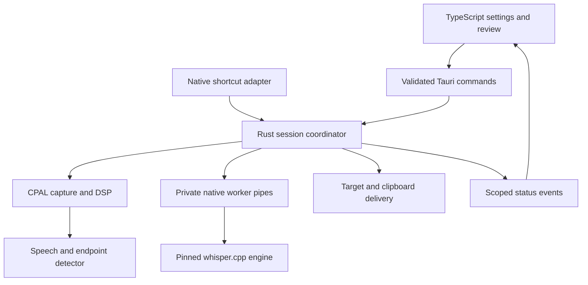
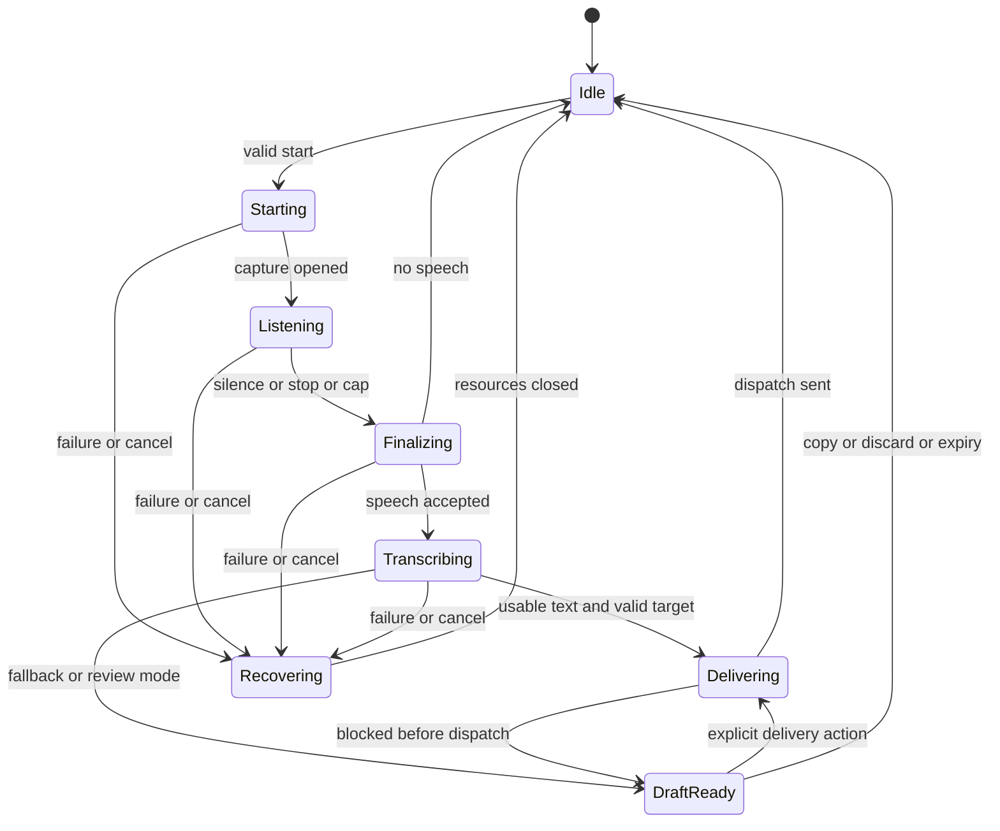

# Local Dictation — Complete Build Specification

Version 1.0 · 12 November 2026

This single-file edition combines the complete document set. The ZIP contains the individual Markdown files for use in an agent harness.


---

<!-- Source: docs/00_SPEC_OVERVIEW.md (the repository README until v0.9.0) -->

# Local Dictation — Native Desktop Build Kit

Version 1.0 · 12 November 2026 · Status: implementation specification, not an implemented or benchmarked application.

Build a small tray/menu-bar dictation utility using Rust, Tauri 2, and a TypeScript UI. A global shortcut starts microphone capture. A second shortcut press or sustained silence finishes recording. A bundled local Whisper engine transcribes it; the app pastes the result into the original focused application when the target is still valid, or retains a draft for explicit delivery.

## Recommended product decisions

- Rust owns capture, shortcuts, session state, model management, transcription coordination, and text delivery. TypeScript renders onboarding, settings, status, and drafts.
- Tauri 2 + Vite + React + TypeScript. No web server, Python runtime, cloud inference, account, or browser microphone APIs.
- A persistent, bundled native worker links a pinned whisper.cpp build. Parent/worker communicate through private inherited pipes; there is no localhost HTTP service. CPU inference is mandatory; Metal acceleration is a gated optimization.
- Phrase-at-a-time transcription in v1. Toggle-to-dictate, automatic stop after silence, and explicit stop are mandatory. Push-to-talk is a later enhancement.
- Base multilingual Whisper is the initial balanced candidate; small multilingual is an optional quality profile. Final defaults require the prescribed measurements, especially for German and Indonesian.
- macOS Apple Silicon first, Windows x64 second, Linux X11 experimental third. Linux Wayland offers manual workflow until a specific compositor/portal integration is tested. These are release priorities, not a request to change the specified stack.
- No persistent transcript/audio history by default. One draft may remain in memory for recovery. Clipboard exposure is clearly explained.

## Reading order

| File | Purpose |
|---|---|
| [01_PRD.md](docs/01_PRD.md) | Scope, behavior, requirements, acceptance criteria |
| [02_UX_AND_FLOWS.md](docs/02_UX_AND_FLOWS.md) | Screens, keyboard behavior, copy, accessibility |
| [03_ARCHITECTURE.md](docs/03_ARCHITECTURE.md) | Runtime components, threading, audio and model pipelines |
| [04_STATE_AND_CONTRACTS.md](docs/04_STATE_AND_CONTRACTS.md) | Session machine, IPC, worker protocol, configuration |
| [05_PLATFORM_AND_DELIVERY.md](docs/05_PLATFORM_AND_DELIVERY.md) | Permissions, target tracking, clipboard and paste algorithms |
| [06_SECURITY_AND_PRIVACY.md](docs/06_SECURITY_AND_PRIVACY.md) | Threat model, data lifecycle, trust boundaries |
| [07_IMPLEMENTATION_PLAN.md](docs/07_IMPLEMENTATION_PLAN.md) | Dependency-ordered work packages and completion gates |
| [08_TEST_AND_BENCHMARK_PLAN.md](docs/08_TEST_AND_BENCHMARK_PLAN.md) | Fixtures, integration tests, performance and release gates |
| [09_ADRS_AND_RISKS.md](docs/09_ADRS_AND_RISKS.md) | Decisions, alternatives, risks and unresolved spikes |
| [10_RELEASE_AND_OPERATIONS.md](docs/10_RELEASE_AND_OPERATIONS.md) | Packaging, supply chain, support and release process |
| [11_AGENT_HANDOFF.md](docs/11_AGENT_HANDOFF.md) | Instructions and first tasks for a coding agent |
| [12_SOURCES.md](docs/12_SOURCES.md) | Official references and evidence boundaries |

## Authority and changes

PRD defines product behavior. State/contracts define ordering and invariants. Platform document defines delivery safeguards. If these conflict, stop the affected work and record a small ADR; do not silently weaken a safeguard. Numerical defaults are proposals and performance values are targets, not measured results. Source references [S1]–[S13] distinguish external platform facts from our implementation choices. Dependency versions must be pinned during the first engineering milestone; this kit deliberately does not fabricate a tested compatibility matrix.

## Definition of a successful first release

On a clean supported Mac, the user can grant microphone and Accessibility access, install or import a model, press a configured shortcut in a text editor, dictate, wait for silence, and receive one text insertion without the dictation app taking keyboard focus. Offline operation, cancellation, focus-change fallback, permission denial, and Unicode delivery must pass before release.


---

<!-- Source: docs/01_PRD.md -->

# 01 — Product requirements

## 1. Problem and outcome

Typing interrupts thought and can be slow or uncomfortable. Users need a lightweight desktop utility that turns a short spoken phrase into editable text in the application they are already using. Processing must run on the user's machine without sending recordings to a service.

Primary outcome: successful short dictation with minimal UI interaction. A successful automatic delivery means the intended text is observed in a controlled target during tests; in production the app can usually confirm only that paste input was dispatched. Product messages must respect that distinction.

## 2. Users and jobs

| User | Job | Product implication |
|---|---|---|
| Writer or office worker | Dictate paragraphs into mail, notes, and documents | Preserve focus; reliable Unicode and punctuation |
| Developer | Dictate comments and issue text | No shell execution, no automatic Enter, explicit newlines only |
| Privacy-conscious user | Work without uploading voice | Fully local capture and inference; offline import |
| Multilingual user | Dictate English, German, or Indonesian | Multilingual model and explicit language selection |
| User with accessibility needs | Avoid complex mouse interaction | Keyboard setup, visible state, configurable shortcut |

## 3. Scope and release tiers

P0 is required for the first macOS release. P1 adds Windows and conveniences after P0 gates. P2 is exploratory. A supported platform must meet its own gates; compilation alone is not support.

| ID | Priority | Requirement and acceptance |
|---|---|---|
| FR-01 | P0 | Tray/menu-bar resident app; closing settings leaves the app running; explicit Quit stops capture and worker. |
| FR-02 | P0 | Configurable global toggle shortcut. First key-down begins; second distinct key-down stops. Auto-repeat and key-up do not toggle. A conflicting shortcut leaves the old valid binding active and shows an error. |
| FR-03 | P0 | Microphone selection and level test. Capture uses the chosen device only. If unavailable, show a device error and ask for reselection; never silently switch a live recording. |
| FR-04 | P0 | Native audio capture with visible listening indicator. Capture begins only after a deliberate start action; no idle microphone stream. |
| FR-05 | P0 | End after sustained post-speech silence; configurable 500–2500 ms, default 1000 ms. Explicit stop bypasses this timer. No speech within 8 s ends with “No speech detected” and no transcription or clipboard write. |
| FR-06 | P0 | Entire inference runs locally with no cloud fallback. Installed model works with networking disabled. |
| FR-07 | P0 | Supported settings: automatic language detection, English, German, Indonesian. Use transcription, never translation; no LLM rewriting. |
| FR-08 | P0 | Default automatic paste on validated supported targets. Capture target before showing UI. A changed/unknown target yields an in-memory draft without auto-copy or paste. |
| FR-09 | P0 | Explicit Copy and “Paste to focused app” recovery actions; the latter is a separately configured global shortcut. No automatic retry following a dispatched paste. |
| FR-10 | P0 | Global cancel shortcut active during a session, plus tray Cancel. Cancellation invalidates all outstanding session callbacks and forbids subsequent text delivery. |
| FR-11 | P0 | Download approved model with progress/cancel/resume or import approved local model offline. Verify bytes and SHA-256 against a bundled manifest before activation. |
| FR-12 | P0 | Errors preserve a completed text draft in memory when available; audio and text never appear in logs by default. |
| FR-13 | P0 | Settings persist atomically and migrate by schema version. No persistent audio or transcript history. |
| FR-14 | P0 | New capture while busy is rejected with status; no hidden queue and no simultaneous sessions. |
| FR-15 | P0 | Session maximum 120 s. At the cap, finish and transcribe, with a visible “Maximum recording length reached” notice. |
| FR-16 | P0 | If a draft exists, new recording does not overwrite it. A Settings/Review action must copy or discard the draft first. |
| FR-17 | P1 | Windows x64 release with native capture, shortcut, Unicode clipboard and ordinary target paste, independently tested. |
| FR-18 | P1 | Optional push-to-talk with explicit key-release and lost-release behavior. Not part of v1 toggle semantics. |
| FR-19 | P2 | Linux X11 tested adapter; compositor-specific Wayland portal experiments. Never advertise universal Linux auto-paste. |

## 4. Core workflow

1. User focuses an editable field and presses their dictation shortcut.
2. Rust checks readiness and captures a target token; permission dialogs belong in onboarding, not the recording path.
3. App starts capture and displays a non-activating indicator. Speech onset is detected after a short sustained voiced interval.
4. User speaks. Silence timer resets whenever speech resumes. A second shortcut press can finish immediately.
5. App releases the microphone, finalizes audio, transcribes locally, and checks the transcript for empty or rejected output.
6. Delivery validates permissions, focus, target exclusions, and released shortcut modifiers. If safe, stage plain text and send exactly one paste chord.
7. Show “Paste sent” or retain a draft with a specific explanation. Never imply the app read back the receiving document.

## 5. Defaults

| Setting | Default | Allowed behavior |
|---|---|---|
| Trigger | Toggle | One registered configurable chord; onboarding proposes Ctrl+Alt+Space and checks actual registration |
| Cancel | Ctrl+Alt+Escape candidate | Active only while busy; handle conflict explicitly; tray Cancel always exists |
| Paste draft | Ctrl+Alt+V candidate | Explicit opt-in binding, useful after focus-change fallback |
| Language | Auto | Explicit language preferred for very short phrases |
| Model | Base multilingual candidate | Optional Small multilingual; CPU baseline mandatory |
| Silence | 1000 ms | 500–2500 ms in 100 ms steps |
| No speech timeout | 8000 ms | Advanced config 3000–15000 ms |
| Maximum capture | 120000 ms | Fixed v1 resource cap |
| Pre-roll | 300 ms | Only within an explicitly active recording |
| Post-roll | 200 ms | Included from already recorded silence; never wait twice |
| Model residency | Keep while app runs | Explicit Unload action; no inference/capture in idle |
| Draft retention | Memory only | 10 minute TTL; explicit clear; cleared on quit/lock |
| Clipboard | Leave dictation text | Clearly disclosed; optional preservation mode described separately |
| Launch at login | Off | User opt-in only |

Shortcut candidates are product defaults, not guaranteed free OS combinations. Keyboard layout and system reservations must be tested.

## 6. Nonfunctional requirements

- Privacy: zero audio/transcript network traffic; no listener on TCP/UDP ports. Model/update traffic is separate and user initiated in v1.
- Latency: warm start-to-first-captured-sample p95 ≤300 ms; end-of-speech-to-stop uses configured silence threshold plus ≤200 ms scheduling overhead; 10 s phrase stop-to-paste-dispatch p95 ≤3 s on the designated reference Mac using the selected base profile. These are release targets, not universal promises.
- Reliability: no duplicate dispatch in deterministic and fault-injection tests; no dispatch after cancellation or target mismatch.
- Responsiveness: inference and audio processing never block UI/main thread. Settings remain responsive during inference.
- Resources: 120 s mono float32 audio is 7.68 MB at 16 kHz. Explicit budgets must also include native-rate ring buffer, resampler, model, tensors and webview. Reference base-profile total RSS target ≤1 GB; idle CPU mean <1% of one logical core over 60 s with UI closed.
- Accessibility: keyboard-operable screens, accessible names, sufficient contrast, reduced motion, and non-color status cues. Status announcements must not spam assistive technology with meter updates.
- Offline: clean import plus inference must work without any downloader. Installation prerequisites and OS webview dependencies are documented by platform.

## 7. Non-goals

Always-on wake words, meeting recording, speaker diarization, translation, remote inference, LLM cleanup, command execution, clinical accuracy certification, password-field dictation, guaranteed insertion into every app, and persistent transcript history are outside v1.

## 8. Acceptance scenarios

- Given an installed model and approved permissions, dictating “Hallo, das ist ein Test” into TextEdit inserts once and leaves focus in TextEdit.
- Given no speech, eight seconds elapse and recording closes without clipboard mutation.
- Given a pause shorter than threshold, the same session continues; after threshold, it finishes exactly once.
- Given focus changes during inference, the transcript becomes a draft and neither app receives automatic text.
- Given user cancel during inference, a late worker result is discarded and no paste occurs.
- Given input-denied permission, the app can still offer Copy after transcription when capture was permitted.
- Given a corrupt model download, the model is never loaded and the last valid model remains intact.

## 9. Product metrics and boundaries

Measure locally during opt-in testing: session completion, fallback reasons, end-to-end latency, WER/CER, and controlled-target insertion success. Production analytics are absent in v1. Logs cannot prove correct insertion into arbitrary third-party apps. Ship only with an explicit supported-app list and transparent limitations.


---

<!-- Source: docs/02_UX_AND_FLOWS.md -->

# 02 — UX and interaction specification

## 1. Interface surfaces

The normal interaction has no main window. A menu-bar/tray icon exposes status, Start/Stop, Cancel, Review draft, Settings, and Quit. Recording uses a compact, non-activating HUD near the lower center of the active display, avoiding common text-caret areas. Position can be adjusted in settings. Do not assume Tauri's always-on-top flag alone creates a truly non-activating panel; prove the native adapter during the first spike.

| Surface | Content | Focus policy |
|---|---|---|
| Tray menu | Readiness, current mode, commands | Opening it may change focus; active session target is then revalidated |
| Listening HUD | Mic icon, “Listening”, level bars, elapsed time, stop hint | Native non-activating, no keyboard focus |
| Transcribing HUD | “Transcribing locally…”, elapsed processing time, cancel hint | No focus and no guessed percentage |
| Draft banner | “Text ready — target changed. Review or paste with your shortcut.” | No automatic editor opening |
| Review window | Editable draft, Copy, Discard, retention countdown | Deliberately takes focus; automatic delivery is disabled |
| Settings | Devices, shortcut, models, language, silence, permissions, privacy | Ordinary accessible window |

If a reliable HUD cannot be implemented on a platform, use tray-only status rather than a focus-stealing replacement. HUD transport exposes no transcript or target metadata.

## 2. Onboarding

1. Welcome: “Dictate into your apps. Speech is processed on this computer.” State that copied/pasted text is exposed to the OS clipboard and potentially clipboard history/sync.
2. Microphone: explain why access is needed, request on explicit Continue, show device list and Test microphone. Testing opens capture only while this page's test is active and closes on navigation.
3. Model: show multilingual Base and Small candidates, manifest-derived download size, installed disk usage estimate, CPU/Metal label, and import option. Never invent fixed memory or latency figures before measurements exist.
4. Shortcut: editable chord capture field and OS registration check. Failed registration must not advance as if successful.
5. Automatic paste: explain Accessibility on macOS or platform limitations; offer “Enable automatic paste” or “Use copy only.” Recheck after returning from OS settings.
6. Trial: a local onboarding text field makes one supervised capture/transcribe/deliver cycle. Explain that this verifies setup, not all destination applications.
7. Done: show the selected chord and the menu-bar location. Keep autostart off unless selected.

Readiness requires a valid device, capture permission, verified model, worker health, and trigger binding. Paste permission is separate: lack of it allows a copy-only workflow with explicit Copy.

## 3. Settings structure

| Page | Controls |
|---|---|
| General | Launch at login, show HUD, reduced motion, tray icon behavior |
| Recording | Microphone, test meter, silence threshold, no-speech timeout, selected-device policy |
| Shortcuts | Dictation toggle, cancel, optional paste draft, conflict messages |
| Transcription | Model, language, CPU/Metal preference, unload model, inference status |
| Models | Installed/available entries, verified state, progress, cancel/import/delete |
| Delivery | Automatic paste or copy-only, app exclusions, clipboard policy, platform capability status |
| Privacy | Data lifecycle explanation, Clear draft, redacted diagnostics export |
| About | Version, engine revision, licenses, supported OS, manual update link |

Model deletion/switching is disabled while its worker job is active. Apply microphone/model changes after the session, never mid-recording. Threshold changes likewise affect the next session.

## 4. Interaction details

- Holding the toggle chord must not repeatedly start and stop. Require release before accepting the next toggle press.
- Cancel uses a scoped global chord and tray action. Escape by itself only cancels when a dictation-owned window has focus; globally capturing Escape would interfere with the receiving app.
- Opening Review intentionally opts out of pending automatic paste. Editing a draft creates a new draft revision; a stale delivery request must fail validation.
- Starting while a draft exists shows “Review, copy, or discard your previous text first.” It must not discard silently.
- Start/stop sounds are off by default; if enabled, stop the start cue before opening capture so it is not recorded. Do not use an inference-complete sound that hides delivery failure.
- Never append Enter/Return. Preserve transcript line breaks only; no automatic message send or terminal execution.
- Do not silently retry after a paste attempt: a receiving editor may already contain the text.

## 5. Status and error copy

| Condition | Copy | Recovery |
|---|---|---|
| Model not installed | “Install or import a local model to begin.” | Open Models |
| Microphone denied | “Microphone access is disabled.” | Open platform privacy settings; recheck |
| Selected mic removed | “Your selected microphone disconnected. Recording stopped.” | Discard incomplete audio; select device |
| Initial silence | “No speech detected.” | Return ready; no draft |
| Low-quality/empty result | “No usable text was recognized. Try speaking closer to the microphone.” | Clear audio; retry |
| Target changed | “Text ready. The focused app changed, so automatic paste was skipped.” | Review / explicit paste shortcut |
| Clipboard unavailable | “Text ready. The clipboard is busy.” | Copy retry, no automatic paste retry |
| Input dispatch blocked | “Automatic paste is unavailable here. Your text is ready to copy.” | Review/Copy |
| Input sent | “Paste sent.” | No automatic resend |
| Worker timeout | “Local transcription took too long.” | Clear audio; restart worker; retry recording |
| Clipboard restore skipped | “Clipboard changed; your newer clipboard content was kept.” | Informational only |

No error notification contains the spoken text. Permission denial is a supported state, not a fatal crash. Notifications with sensitive text are prohibited.

## 6. Accessibility and localization

Use semantic controls and visible labels; meter bars are decorative with one stable accessible label. Announce phase transitions, never every audio frame. Use at least 4.5:1 text contrast, visible focus rings, 200% text zoom and keyboard navigation. Support VoiceOver first, then Narrator for Windows. UI starts in English with localization keys for German and Indonesian; transcription language is independent of UI locale. Avoid transcript normalization that strips umlauts or changes Indonesian names.


---

<!-- Source: docs/03_ARCHITECTURE.md -->

# 03 — Technical architecture

## 1. Runtime architecture

Tauri provides a native desktop host using the OS webview; the UI is TypeScript, rather than native widget code. Rust owns all device and OS integrations. The frontend must never call getUserMedia or perform inference.



The coordinator is the only owner allowed to advance a session or authorize delivery. Audio, inference, and UI callbacks submit typed messages to it. No callback may paste directly.

## 2. Suggested repository layout

| Path | Responsibility |
|---|---|
| `src/` | React/TypeScript UI, presentation state and generated bindings |
| `src/features/onboarding/` | Permission, model and trial flow |
| `src/features/settings/` | Validated forms, status and model management |
| `src/features/draft/` | In-memory review UI |
| `src-tauri/src/commands/` | Small validated IPC entry points |
| `src-tauri/src/coordinator/` | State machine, session ownership and cancellation |
| `crates/audio/` | Capture, format conversion, resampling, endpointing |
| `crates/transcription-protocol/` | Shared versioned worker wire types |
| `crates/transcription-worker/` | Pipe server, whisper.cpp FFI wrapper |
| `crates/platform/` | Target probe, permissions, shortcuts, input/clipboard backends |
| `crates/models/` | Manifest, download/import, hashing, activation |
| `crates/domain/` | Pure types, configuration, errors and policies |
| `vendor/whisper.cpp/` | Pinned source/submodule and build integration |
| `tests/fixtures/` | Consented synthetic/licensed audio and expected results |
| `docs/` | This specification, decisions and platform evidence |

## 3. Concurrency and lifecycle

- Main/GUI thread: OS-required window, tray and platform calls only; schedule work rather than block.
- Audio callback: convert/copy samples into a preallocated bounded ring. No locks with unbounded wait, file writes, network requests, inference, or UI event emission. CPAL's callback is real-time code [S6].
- DSP worker: drain ring, channel-downmix, resample, calculate levels and classify speech. Send meter events at ≤15 Hz. Hold a bounded normalized utterance buffer.
- Coordinator actor: consume start/stop/cancel/endpoint/error messages sequentially; own session ID, draft, target token and dispatch ledger.
- Model I/O tasks: bounded downloader, verification and atomic manifest/config operations.
- Native inference worker: one process, one loaded model, one job at a time. Fixed-length private IPC; no TCP endpoint.

Keep the worker warm after the first model load. Quit closes capture, invalidates session, asks worker to exit, then kills it after a two-second grace period. Parent liveness is tied to pipe EOF; worker exits on EOF. On Windows use a job object or equivalent child-lifetime mechanism; verify no orphan processes. Single-instance enforcement prevents duplicate shortcuts and microphone ownership.

## 4. Capture and DSP pipeline

1. Enumerate devices and query supported stream configurations. Use a supported native sample rate and channel count; do not assume hardware offers 16 kHz.
2. Accept known supported native integer/float formats and convert to bounded finite float samples. Reject NaNs and impossible format metadata.
3. Downmix channels with normalized weights (initially arithmetic mean). Document that phase-cancelled stereo input may require explicit mono-channel selection later.
4. Resample statefully to 16 kHz mono using a maintained Rust resampler candidate, selected and pinned in milestone M0. Test arbitrary block boundaries, 44.1/48 kHz input, drift and final flush.
5. Assemble 20 ms frames: 320 samples at 16 kHz. Convert a copy to signed i16 for the WebRTC VAD candidate. Float32 remains the Whisper input.
6. Keep the last 300 ms of active-session audio as pre-roll. Detect onset after three voiced frames within a five-frame window. A voiced frame must pass VAD plus a conservative calibrated energy floor; use RMS primarily for UI/noise diagnostics, not as the sole speech classifier.
7. After onset, append speech and intervening pauses. A default 1000 ms of consecutive unvoiced frames triggers finish. Include 200 ms of recorded trailing silence. If speech resumes before threshold, reset the timer without splitting the phrase.
8. Explicit stop uses available audio without waiting for silence. With no confirmed speech, finish as no-speech. A <200 ms confirmed speech span is too short and yields no inference; minimum length is tunable from the fixture results.
9. At 120 s total capture, finalize exactly once. On overflow/disconnect/format failure, abort the session with an error instead of transcribing a silently truncated recording.

The WebRTC VAD choice is a design proposal; validate a maintained native binding and license in M0. It is independent of the transcription engine. If the candidate cannot pass fixtures, replace it with a pinned Silero-based local detector behind `SpeechDetector`; record an ADR. whisper.cpp itself documents a VAD integration, which can be evaluated as that alternative [S1].

Only close the microphone when capture ends; do not keep it open for inference. Resampler tails must be flushed once and included consistently. Endpoint time is computed from sample/frame counts and monotonic clocks, not wall-clock time.

## 5. Inference implementation

Use a bundled `dictation-worker` native binary that links whisper.cpp built from a pinned revision [S1]. Generate a narrow Rust FFI layer from that revision's C header or use a maintained wrapper only after compatibility validation. The app's `TranscriptionEngine` trait hides that choice. No external executable on PATH is trusted.

The worker receives validated float32 PCM and a selected language. Run transcription task, not translate. Disable cross-session context carryover. Capture segment text, language result, timing, and available diagnostic scores. Scores are heuristic signals, not calibrated confidence probabilities.

Recommended initial decoding: greedy/low-temperature deterministic path; bounded CPU threads (candidate min(available logical CPUs, 8)); no word-timestamp requirement; suppress non-speech tokens where supported by the pinned API. Map options using actual headers rather than guessing parameter names. CPU profile must work on every shipped target. Metal is an optional build/profile on Apple Silicon with verified CPU fallback.

Reject empty/whitespace-only output. Strip control characters except tab/newline; trim outer whitespace conservatively. Do not delete diacritics or infer commands from transcript text. Do not ship brittle hard-coded “hallucination word” blacklists. Empty speech and noise are controlled primarily through endpointing plus measured decoder rejection criteria.

Timeout: default 60 s per inference job; UI shows elapsed time. A timeout kills/restarts the worker and discards audio. Worker error or crash never triggers a cloud fallback. Re-running canceled audio is prohibited. User retries require a new capture.

## 6. Model pipeline

Bundled trusted manifest fields: model ID, semantic profile, engine format/revision compatibility, language coverage, exact byte count, SHA-256, download URL/allowed redirects, source, license reference and measured resource notes. Manifest data is part of the signed app; no arbitrary remote executable or URL supplied by the frontend.

Download to private `.partial` file, enforce maximum bytes, hash streaming bytes, fsync as appropriate and atomically rename on success. Resume only with validated range/ETag behavior; otherwise restart safely. Only verified files can become active. Offline import uses a native picker, streams from the selected regular file, and validates against approved manifest hashes. Custom untrusted models are outside v1.

Load a newly selected verified model in the worker and run a smoke fixture before committing active selection. If load fails, restart with the previous model. Validate ownership, permissions and file identity again before opening; avoid symlink substitution. Updating the app does not delete installed compatible models.

## 7. Dependency policy

Use Tauri 2 stable and its matching official plugin generation; Rust stable with a pinned toolchain; strict TypeScript; lock Cargo and package manager dependencies. Candidate libraries: CPAL, a stateful Rust resampler, WebRTC VAD binding, serde, Tokio for non-real-time I/O, tracing with redaction, SHA-256 implementation and platform-specific OS bindings. Evaluate licenses, maintenance and actual target support before pinning. These candidates are not a claim that arbitrary current versions work together.


---

<!-- Source: docs/04_STATE_AND_CONTRACTS.md -->

# 04 — State machine, IPC and data contracts

## 1. Orthogonal state

Maintain `Readiness` separately from `SessionPhase`. Readiness contains microphone, model, worker, shortcut and delivery capabilities with reason codes. Copy-only is usable readiness; automatic delivery permission is not a prerequisite for capture. `NotReady` is not a hidden recording phase.

Session phases: Idle, Starting, Listening, Finalizing, Transcribing, Delivering, DraftReady, and Recovering. Error/no-speech/cancel notifications are outcomes that transition to Idle or Recovering rather than trapping the machine in a modal Error state.



Cancellation while Delivering is serialized with the dispatch commit: if processed before commit it blocks the send; after commit it cannot retract text already sent. Show that outcome honestly. A partial/uncertain OS send clears automatic retry eligibility and retains an “attempted” draft requiring explicit confirmation before any resend.

## 2. Invariants

1. At most one capture, worker job and automatic delivery transaction exist.
2. Each session has an unguessable ID, a generation counter, immutable capture settings and a cancellation token.
3. Stop/endpoint races are idempotent: the first valid finish request wins.
4. Every async response must match current session ID, generation, worker epoch and allowed phase.
5. Cancellation invalidates delivery eligibility before tearing down resources. Late results are discarded.
6. The delivery ledger records `not_attempted`, `committed`, `sent` or `uncertain`. A session can cross commit only once automatically.
7. No initial speech means no inference, clipboard read/write, or input send.
8. UI cannot provide arbitrary PCM, executable paths, model URLs, key sequences, target PIDs or automatic-delivery tokens.
9. Opening Review revokes automatic delivery eligibility.
10. Sleep, session lock and logout cancel capture/inference, clear draft, and revoke pending delivery. Unlock never resumes a recording automatically.

## 3. Tauri commands

Rust serde types are the contract source. Generate TypeScript bindings or maintain a checked generated artifact. All mutating requests carry a request ID for deduplication. Validate enum values and numeric ranges again in Rust.

| Command | Input | Response and boundary |
|---|---|---|
| `get_snapshot` | none | Versioned readiness/settings/session snapshot; no raw target token |
| `start_dictation` | request ID | Session ID or typed error; no arbitrary device override |
| `stop_dictation` | request ID, session ID | Acknowledgment only; current phase reconciled via snapshot |
| `cancel_dictation` | request ID, session ID | Acknowledgment; invalidates immediately in coordinator |
| `list_input_devices` | none | Opaque session-stable device IDs and display names |
| `start_mic_test` / `stop_mic_test` | request ID | Exclusive test mode; no parallel dictation |
| `update_settings` | expected settings revision, validated patch | New revision or conflict; applies to next capture |
| `get_models` | none | Manifest-derived model status |
| `install_model` | request ID, approved model ID | Background operation ID |
| `cancel_model_install` | operation ID | Acknowledgment |
| `import_model` | approved model ID | Rust-owned picker/import; UI cannot supply unrestricted path |
| `remove_model` | model ID | Reject if active/in-use without explicit switch |
| `check_permissions` | none | Enumerated permission status, not fabricated bools |
| `request_permission` | explicit permission kind | User-initiated native workflow |
| `get_draft` | draft ID | Review-window only, text and revision |
| `edit_draft` | draft ID, expected revision, text | Validated bounded new revision |
| `copy_draft` | draft ID, revision | Explicit copy; marks completion and clears app draft after success |
| `discard_draft` | draft ID | Clear memory; no clipboard mutation |
| `export_diagnostics` | none | Redacted native save flow, no audio/transcript |

Draft paste is primarily a Rust global-shortcut action: capture the currently focused external target at that deliberate press, validate it, wait for modifiers up, then deliver. A button inside Review cannot reliably select an external caret; label the UI with instructions to focus the destination and use the configured shortcut. No frontend `send_keys` or shell execution command exists.

## 4. Events and reconciliation

Use a scoped Tauri channel or targeted event per window, not an application-wide broadcast containing sensitive data. Envelope:

```typescript
type EventEnvelope<T> = {
  schemaVersion: 1;
  sequence: number;
  sessionId?: string;
  generation: number;
  kind: string;
  payload: T;
};

type Phase = 'idle' | 'starting' | 'listening' | 'finalizing'
  | 'transcribing' | 'delivering' | 'draftReady' | 'recovering';

type AppError = {
  code: 'NOT_READY' | 'BUSY' | 'SHORTCUT_CONFLICT' | 'MIC_DENIED'
    | 'MIC_DISCONNECTED' | 'AUDIO_OVERFLOW' | 'MODEL_INVALID'
    | 'MODEL_UNAVAILABLE' | 'WORKER_CRASH' | 'INFERENCE_TIMEOUT'
    | 'TARGET_CHANGED' | 'PASTE_UNSUPPORTED' | 'CLIPBOARD_BUSY'
    | 'INPUT_UNCERTAIN' | 'STALE_REQUEST' | 'SETTINGS_CONFLICT';
  messageKey: string;
  retryable: boolean;
};
```

Events: phase_changed, readiness_changed, mic_level, model_progress, draft_available, operation_failed. `draft_available` carries ID, expiry and reason, not text. HUD receives only phase, elapsed time, normalized level and hints. Sequence numbers let clients detect gaps and call get_snapshot; snapshots are authoritative after reconnect. Never assume the webview was open when a transition occurred.

## 5. Native worker wire protocol

Version 1; inherited stdin/stdout anonymous pipes. stdout is binary protocol only; stderr is bounded redacted diagnostics. No transcript text in stderr. One reader and one writer per direction. All messages use a 4-byte little-endian unsigned length followed by a UTF-8 JSON envelope, maximum envelope 256 KiB. Reject malformed lengths before allocation.

Sequence: worker sends Hello(protocol, engine revision, backend capabilities); parent validates; parent sends LoadModel(approved absolute path, model hash); worker replies ModelReady or Error. Parent alone resolves that path. Then Transcribe(session ID, generation, worker epoch, language, sample count, PCM byte length) is followed immediately by exactly sample_count×4 little-endian float32 bytes. No interleaving frames inside a PCM payload. Sample count ≤1,920,000 (120 s), PCM ≤7,680,000 bytes. Parent checks finite sample values; worker validates again. Partial payload/EOF aborts the job.

Result: job identity, text, detected language if available, duration and bounded diagnostics. Output text limit 32 KiB before JSON escaping; serialized result must also fit the 256 KiB envelope cap. Progress is optional elapsed/phase only, never a fabricated percentage. Cap decoder segment count and total runtime too. Define shared types in `transcription-protocol` and golden-test framing and bounds.

Hard cancellation: invalidate the job, close pipes and kill the worker process; wait for exit, then restart/load if still needed. This is simpler and more reliable than assuming a particular FFI wrapper can safely interrupt native inference. Keep no worker cache of canceled audio. A cooperative abort callback may be added after proof, but does not replace the generation checks.

## 6. Persistent configuration

```json
{
  "schema_version": 1,
  "revision": 1,
  "audio": {
    "device_id": null,
    "silence_ms": 1000,
    "no_speech_timeout_ms": 8000,
    "max_capture_ms": 120000
  },
  "transcription": {"model_id": "whisper-base-multilingual", "language": "auto", "backend": "auto"},
  "delivery": {"mode": "auto_paste", "clipboard_policy": "leave_text", "excluded_apps": []},
  "shortcuts": {"toggle": "Ctrl+Alt+Space", "cancel": "Ctrl+Alt+Escape", "paste_draft": null},
  "ui": {"show_hud": true, "launch_at_login": false, "locale": "en"}
}
```

This is an application schema example, not a Tauri configuration snippet. OS adapters map normalized chords to actual key representations. `device_id: null` means select/confirm the system default during setup; once selected, persist best-effort device identity and require reselection when missing. No target token, transcript, PCM, clipboard snapshot or permissions grant is persisted. Read OS permission state rather than trusting a saved grant.

Write config to a private temporary sibling and atomically replace after validation. Detect corrupt or future schemas, retain a backup, and offer reset rather than destructive downgrade. Model inventory is separate; transient `.partial` files never count as installed models.


---

<!-- Source: docs/05_PLATFORM_AND_DELIVERY.md -->

# 05 — Platform permissions and text delivery

## 1. Support policy

| Platform | Release tier | Capture/trigger | Automatic delivery |
|---|---|---|---|
| macOS Apple Silicon | First release | CPAL/CoreAudio; official shortcut plugin candidate | Native target probe, paste chord; Accessibility permission and tested non-activating HUD |
| macOS Intel | Later qualification | Same design; separate binary/build validation | Only after measured compatibility; no implied support from universal build |
| Windows x64 | Second release | CPAL/WASAPI; official shortcut plugin candidate | Native foreground HWND check and SendInput; ordinary integrity targets only |
| Linux X11 | Experimental | CPAL supported host; X11 shortcut adapter | X11 target/clipboard/input backend on named tested desktops |
| Linux Wayland | Manual workflow initially | In-app recording; global shortcut only after actual portal support test | Manual Copy; automatic paste remains disabled until compositor-specific validation |

Choose minimum supported OS versions in M0 based on Tauri/system-webview prerequisites and tested machines. Do not infer support from a browser's reported OS string. Installer documentation must publish exact tested OS/build/architecture values before release.

Tauri's global-shortcut plugin exposes desktop shortcut registration [S2]. That does not establish that every Linux compositor supports the required global behavior. Wayland GlobalShortcuts and RemoteDesktop are separate portal interfaces [S9, S10]; a shortcut portal does not itself grant input injection, clipboard access, or reliable target identity. Runtime-probe each capability and degrade explicitly.

## 2. macOS permissions

- Include a clear `NSMicrophoneUsageDescription` in Info.plist [S11]. Use a direct native microphone authorization flow where needed; permission request must occur on user action.
- Configure microphone/audio-input entitlement as appropriate to the actual signing/hardened-runtime/sandbox configuration; verify the signed release artifact on a clean machine. Do not assume debug behavior represents distribution behavior.
- Check Accessibility trust through Apple's APIs and prompt only in the explicit “Enable automatic paste” flow [S8]. A System Settings link plus recheck is required; the grant is not immediate merely because a dialog opened.
- Global shortcut registration is not a request for broad keyboard surveillance. Do not add a general keylogger. Assess Input Monitoring only if the chosen implementation actually needs it; avoid requesting unnecessary access.
- Do not request Screen Recording or Apple Events Automation simply to paste. Native frontmost-app and Accessibility target checks should be investigated first.
- Use a stable bundle identifier and properly signed/notarized build so permissions and app identity behave predictably across updates [S12]. Never advise users to disable platform security as the installation path.

## 3. Windows permissions and limitations

Use native desktop capture and document OS microphone privacy controls, including denial for desktop applications. Probe the selected device instead of treating device enumeration as permission success. Do not request administrator privileges for normal use.

GetForegroundWindow and native process/window identity form the target token. Keyboard input uses a tested SendInput implementation; the API is constrained by User Interface Privilege Isolation, so it cannot reliably inject into higher-integrity targets [S7]. Elevated programs, UAC/secure desktop, lock screen, and secure credential fields are unsupported. A failed send must not cause automatic escalation or indefinite retries.

Support clipboard Unicode text explicitly. Test WebView2 installation and offline installer behavior; a Tauri executable alone does not remove the system-webview dependency.

## 4. Target token and validation

Capture the target immediately on shortcut start, before any dictation UI interaction. Token includes platform session/desktop identity, process identity resistant to PID reuse, native window identity, and focused editable element identity where available. Hold native Accessibility references safely; serialize no raw pointers to the frontend.

Validate again after inference and immediately before input dispatch:

1. Session is live, has usable text, is not canceled and has no committed delivery.
2. Target is not this app, OS shell/login screen, excluded app, or known protected/secure field.
3. Current foreground process/window matches the start token.
4. If a focused-element token was available, it still matches and is editable/unprotected. Missing/invalid element information is an unknown capability, not evidence of a safe text field.
5. Shortcut modifiers have been released within 1500 ms; otherwise retain a draft without sending keys.
6. Native platform can observe adequate target identity. If not, automatic delivery is disabled for that environment.

If same-window focus moved to another element, skip auto-paste when that can be detected. Caret position changes inside an unchanged field cannot generally be tracked safely without intrusive monitoring. Explain this residual limitation: users should keep the destination focused until completion. A final check cannot make the OS send atomic with focus; test the race, minimize the interval, and never claim a universal guarantee.

For targets whose editable-element identity is unavailable, the first release uses explicit draft delivery, even if a weaker window-only heuristic would be convenient. Add tested app-specific adapters later through an ADR.

## 5. Clipboard transaction: default mode

Default `leave_text` is intentionally simple and disclosed: the recognized phrase remains on the system clipboard after a successful automatic paste attempt or explicit Copy. The app does not claim clipboard privacy or full restoration.

Algorithm:

1. Finish inference and create an in-memory transcript associated with session/draft revision.
2. Run target and permission validation. If blocked, retain draft; do not mutate clipboard.
3. Wait for physical trigger modifiers to be released. Never synthesize releases for physical keys the user is holding.
4. Acquire an application-local delivery lock; OS clipboard locking/retry must be bounded to ≤500 ms. Clipboard write retries are allowed only before input dispatch.
5. Write plain Unicode text. Do not append Return, execute transcript commands, or write HTML.
6. Recheck target. If changed after the write, skip input and retain draft. The clipboard may now contain dictated text; report this accurately. Clipboard mutation cannot be made atomic with focus.
7. Mark dispatch committed and send one complete paste chord (Cmd+V on macOS, Ctrl+V on ordinary Windows editors; target-specific terminal bindings require explicit profile).
8. Always release only synthetic keys issued by this transaction, including on API error. Record sent/uncertain based on actual API return. Never infer document acceptance from SendInput success.
9. Clear active audio/text from app memory after a sent outcome; show “Paste sent.” On blocked/uncertain result retain a draft with outcome metadata and require explicit action for resend.

No automatic Enter. Multiline paste can still have application-specific effects, especially in terminals; terminal targets are excluded from automatic delivery by default. User may enable a named, tested terminal profile after a separate confirmation about pasted commands/newlines. Exclusions are evaluated by native app identity, not a window title alone.

## 6. Optional clipboard preservation

This is P1 and must not block first release. A generic text-only clipboard API cannot restore every native format or promise that the receiving app has consumed data. Tauri's clipboard plugin supplies clipboard operations [S3], not proof of completed paste.

Offer preservation only on adapters that can snapshot all advertised formats and track ownership/revision reliably. Otherwise label it unavailable; do not silently replace an image/rich clipboard with a text-only backup. Bound snapshots (candidate 8 MiB), reject delayed/promised/unsupported data, keep only in memory, and never log contents.

After dispatch, keep clipboard text available for a configurable conservative grace interval (candidate 1500 ms). Restore only if the OS clipboard still has the app's exact ownership/revision token. A text-equality check alone is insufficient. If another app/user changed clipboard ownership, leave the new content alone. Even a grace interval is heuristic because arbitrary apps expose no paste-consumed acknowledgment; preserve mode is best-effort and must say so. Clipboard history, managers and OS sync can retain dictated text despite restoration.

## 7. Copy-only and explicit draft paste

Copy-only sessions create a draft without writing to clipboard. User selects Copy to stage text, then pastes normally. This preserves deliberate clipboard control.

For explicit paste shortcut: user focuses the intended app, invokes paste-draft chord, and Rust captures a new target token at that moment. Validate editable/protected status, draft revision and permissions, release modifiers and run one transaction. This authorizes the newly focused target rather than silently refocusing the original app. If target inspection is unavailable, offer Copy; never force focus to a stale app.

## 8. Qualification matrix

For each target app/version test plain text, selections, multiline, umlauts, emoji, CJK, empty input, text field changes, window switches, secure fields, layout variations and permissions revoked mid-session. First Mac candidates: TextEdit, Notes, browser textarea, mail compose, VS Code editor. First Windows candidates: Notepad, browser textarea, Word compose and VS Code. An app enters the supported list only after the target-element adapter and delivery tests pass.


---

<!-- Source: docs/06_SECURITY_AND_PRIVACY.md -->

# 06 — Security and privacy design

## 1. Trust boundaries

Trusted components: signed Rust host, signed bundled worker and pinned model manifest. Inputs remain untrusted: microphone samples, decoded text, frontend requests, native target metadata, model files on disk, installer/update artifacts and download responses. A local model is a large parser input, not trusted executable logic simply because inference is offline.

Tauri capabilities constrain frontend IPC; they do not sandbox mistakes in Rust [S4]. Configure custom app command permissions explicitly using the current Tauri AppManifest/permission mechanism, verify them in negative tests, and check window labels and request state in Rust. Registered custom commands must not be assumed restricted merely because plugin permissions look narrow [S4].

| Actor | Allowed access |
|---|---|
| Settings webview | Read status/config, validated setting changes, explicit model/permission operations |
| Review webview | Authorized draft ID/revision, bounded edit/copy/discard |
| HUD webview | Status and meter only; no draft, clipboard, device/model path or process APIs |
| Rust host | Native capture, policy, target validation, clipboard/input, worker lifecycle |
| Worker | Verified model read and session PCM over inherited pipes; no intended network use |

Process separation contains worker crashes and enables hard cancellation. It is not a security sandbox unless separately implemented. Do not claim the worker is OS-sandboxed simply because it is a sidecar.

## 2. Threats and controls

| Threat | Control | Remaining limitation |
|---|---|---|
| Speech reaches remote service | No cloud provider or inference endpoint; offline tests and egress inspection | OS services or other installed software are outside app control |
| Frontend compromise sends arbitrary input | No generic send-keys/exec APIs; narrow domain commands; permission and state checks | Rust validation mistakes remain possible |
| Transcript delivered to wrong app | Target token, editable-element recheck, no forced refocus, safe draft fallback | Final focus race and caret movement cannot be eliminated globally |
| Duplicate paste after retry | Per-session dispatch ledger and no automatic post-commit retries | User can explicitly paste twice |
| Clipboard exfiltration/history | Clear disclosure, no idle clipboard monitoring, copy-only choice | Clipboard managers/sync/other local apps can observe clipboard data |
| Corrupt/hostile model | Bundled approved hashes, size limits, atomic activation, worker isolation | Model parser vulnerabilities need upstream fixes |
| Worker pipe memory exhaustion | Frame/sample/text bounds before allocation, timeouts, process cleanup | Native engine allocations need actual RSS testing |
| Long/invalid capture | Fixed cap, bounded rings, finite checks, fail on overflow | Bad drivers can still fail the session |
| Shortcut captures ordinary typing | Register chosen chords only, no continuous key content logging | OS-level registration behavior varies |
| Supply-chain compromise | Lockfiles, pinned engine source, SBOM, signed app/worker, provenance | Signing keys/build systems need protection |

## 3. Data lifecycle

| Data | Location/lifetime | Persistence |
|---|---|---|
| Raw native audio | Bounded host ring while recording | Never intentionally written to disk |
| Normalized utterance | Host memory until sent/failed/canceled | Released after finalization/job handling |
| Worker PCM/tensors | Worker memory during job | Cleared/released on completion; worker killed on cancellation |
| Recognized text | Coordinator and authorized review UI | One memory-only draft, max 10 min |
| Clipboard snapshot | Preservation mode only | Memory only, bounded; deleted after restore decision |
| Clipboard text | OS-managed after paste/Copy | May persist outside app and in OS history |
| Settings/model inventory | OS app config/data directories | Atomic user-owned files |
| Model binaries | Private app model directory | Persist until user removes |
| Diagnostics | Local redacted rolling logs | Default 7 days or 5 MiB, whichever reached first |

On quit/lock/cancel clear sensitive references and overwrite reusable audio buffers where practical. Rust deallocation, native allocators, OS swap and crash dumps prevent a blanket secure-erasure guarantee. Avoid automatic crash dumps containing process memory; never upload dumps automatically. Text copied to the OS clipboard is not recalled on draft expiry.

## 4. Frontend hardening

Bundle all UI assets and fonts. No remote scripts/CDNs, remote navigation or arbitrary embedded websites. Strict CSP with the minimum Tauri IPC/asset origins required by the actual release build; validate exact origins for each OS instead of pasting an untested policy. No `unsafe-eval` in release. Avoid `dangerouslySetInnerHTML`; render transcripts as text. Treat URLs and native paths as untrusted.

Explicitly list enabled capability identifiers. Do not give HUD `core:default`, shell, filesystem or clipboard-wide grants merely for convenience. Rust performs clipboard/model operations; no frontend shell plugin needed. Deny remote webview access and unnecessary dynamic window creation. Validate the generated capability schema in CI.

## 5. Networking policy

After initial model setup/import, capture, inference and delivery require no network. v1 network operations are user-initiated model download and opening the documented update page. No analytics, transcript crash reporting or silent update polling. Downloader enforces HTTPS, approved hosts/redirects and byte limits, and does not include transcript/device/target identifiers in requests.

A later automatic updater requires signed update manifests/artifacts, explicit release policy and separate review. Model checksums bundled with the signed app establish integrity against that manifest; checksums fetched from the same untrusted server as a file are insufficient by themselves.

## 6. Diagnostics

Log codes and timings only: phase transitions, duration buckets, engine revision, model ID, backend, OS/build and permission state. Never log text, PCM, clipboard contents, arbitrary paths, window titles, target field contents or microphone device serials. Process/app identities can be sensitive: redact or omit them from standard exports. Export shows a preview and requires explicit user action.

## 7. Required security evidence

Before release demonstrate: no capture in Idle; no transcript network egress; unauthorized HUD commands rejected; stale/canceled result cannot paste; transcript treated as inert text; modified model rejected; worker path cannot be replaced by a frontend argument; no orphan worker after host death; no secret content in logs/diagnostics; secure-field/excluded-target handling; clipboard failure does not trigger repeated input sends.


---

<!-- Source: docs/07_IMPLEMENTATION_PLAN.md -->

# 07 — Implementation plan and backlog

## 1. Delivery strategy

Build the uncertain native behaviors first, then a complete thin vertical slice, then polish. Estimates below assume one experienced Rust/TypeScript engineer with physical access to target machines. They are rough engineering effort ranges, not delivery commitments; OS permission/signing issues may dominate. First Mac release: approximately 5–8 engineering weeks after a successful feasibility spike. Windows qualification: approximately 2–3 additional weeks. Do not sum overlapping work mechanically.

## 2. Milestones

| Milestone | Effort | Work | Exit evidence |
|---|---|---|---|
| M0 — Feasibility and pins | 3–5 days | Exact toolchains; capture; native HUD; shortcut; target element; paste; worker build; signing experiment | Spike report, pinned dependency matrix, native target and HUD evidence on release-like build |
| M1 — Domain and capture | 4–6 days | Actor, config, session IDs, CPAL ring, resampler, endpoint detector | Deterministic state/audio fixtures and no idle capture |
| M2 — Local engine and models | 4–6 days | Worker protocol, pinned engine, model install/import, CPU inference, cancellation | Offline known fixture transcribed; malformed protocol rejected; no orphan worker |
| M3 — Delivery vertical slice | 4–6 days | Target token, policy, clipboard, one-shot paste, draft recovery | One complete shortcut-to-text flow and focus-change/cancel tests |
| M4 — Product UI | 4–6 days | Onboarding, settings, model progress, HUD, review, accessibility | Keyboard-only setup, permission-denial recovery and trial |
| M5 — Hardening and release | 5–8 days | Corpus benchmarks, soak, signing, installer, diagnostics, docs | All release gates and clean-machine install |
| M6 — Windows | 8–15 days | Native adapter, permission UX, packaging, supported-app matrix | Separate Windows release evidence |
| M7 — Linux experiments | Time-boxed 3–5 days | Named desktop/compositor probing, manual fallback, packaging research | Published limited support matrix; no broad support claim |

## 3. M0 task breakdown

- T0.1 Scaffold Tauri 2 with TypeScript/React/Vite, strict lint/typecheck, Cargo workspace and lockfiles. Pin actual versions in a compatibility document. Confirm OS minimums and physical test machines.
- T0.2 Capture 48/44.1 kHz microphone audio in Rust and prove selected-device permission behavior in a signed app bundle.
- T0.3 Register toggle/cancel chords, filter repeat, detect modifier release without keyboard-content monitoring.
- T0.4 Show a HUD without changing the frontmost app, window, focused field or caret on repeated trials. If impossible, use tray-only and record the reduced UX.
- T0.5 Probe editable element identity in TextEdit and a browser textarea. Show focus changes within the same window are caught or explicitly unsupported.
- T0.6 Stage Unicode clipboard text and dispatch one native paste; inspect actual receiving document in the test harness.
- T0.7 Build whisper.cpp CPU worker, load Base multilingual model, measure a 10 s fixture and validate kill/restart. Verify target naming/signing of bundled executable [S5].
- T0.8 Validate VAD binding maintenance/license/frame requirements and resampler behavior. Freeze candidate or write replacement ADR.

Stop cross-platform auto-paste work if target validation is unprovable on that platform. Continue capture/transcription/copy-only independently; do not pretend the blocker disappeared.

## 4. Work packages

| ID | Depends on | Deliverable | Acceptance |
|---|---|---|---|
| A1 | M0 | Pure domain/state reducer | All legal/illegal transition fixtures; stop race idempotent |
| A2 | A1 | Capture/DSP component | Bounded callback, sample-rate fixtures, disconnect/overflow failure |
| A3 | A2 | Endpointing | Start timeout, pre/post-roll, short pause and cap fixtures |
| B1 | M0 | Shared worker protocol | Binary framing golden tests, limits and EOF handling |
| B2 | B1 | Worker inference | Pinned source, one resident model, bounded result |
| B3 | B2 | Cancellation supervisor | Kill/wait/reload, epoch fencing, no orphan process |
| B4 | B2 | Model manager | Hash/size validation, cancel/resume/import/atomic activation |
| C1 | A1, M0 | Target/permission adapters | Actual editable/secure/unknown classification with evidence |
| C2 | C1 | Delivery coordinator | Commit ledger, modifier release, single dispatch, no forced focus |
| C3 | C2, B3 | Full vertical slice | Inference result delivers once; cancel/focus-change retain safe outcome |
| D1 | A1 | Readiness/config IPC | Revision conflicts, migration, command permission negative tests |
| D2 | D1, B4 | Onboarding/settings | All setup and denial flows, real progress |
| D3 | C3, D1 | HUD/review | No focus stealing, scoped events, memory-only draft |
| E1 | C3, D2, D3 | Regression/bench suite | Corpus, controlled targets and release metrics |
| E2 | E1 | Signed package/docs | Clean offline-capable import test, upgrade/rollback evidence |

## 5. Engineering conventions

Rust core uses typed errors and explicit ownership; OS handles/FFI use narrow RAII wrappers. No unwrap/panic on user/device/model inputs. Callback-safe code is reviewed separately from ordinary asynchronous I/O. Domain tests should not require a webview. Generate TypeScript contract types from Rust where feasible and ensure generation is deterministic.

Prefer a small explicit state store over a large frontend orchestration framework. Frontend state renders coordinator snapshots; it does not determine whether a paste is authorized. No database is necessary for v1 configuration and a single memory-only draft.

CI on pull requests: Rust fmt/clippy/tests; strict TypeScript/lint/UI tests; worker/protocol build; lockfile and license checks. Native tests run on actual OS runners/hardware. macOS global permissions and third-party UI behaviors require a documented manual test path; headless UI tests cannot substitute for those.

## 6. Scope cuts if schedule is constrained

Keep: local CPU inference, correct endpointing, bounded memory, explicit stop/cancel, safe focus fallback, offline import, honest status and privacy behavior. Defer: Metal, clipboard preservation, push-to-talk, autostart convenience, secondary architectures, Linux automatic paste and advanced visual polish. A release may use tray-only status when a non-activating HUD is not proven. Never cut cancellation or target-validation safeguards to meet a date.


---

<!-- Source: docs/08_TEST_AND_BENCHMARK_PLAN.md -->

# 08 — Verification and benchmarks

## 1. Test layers

Pure Rust unit tests cover state transitions, timing, framing and policy. Audio fixture tests cover conversion/resampling/endpointing. Worker integration tests run real local inference. UI tests cover forms, keyboard accessibility and event reconciliation. Native end-to-end tests verify actual receiving text in controlled target apps; permission/signing tests use clean machines and release artifacts.

Do not test only mocks of the exact implementation. A mocked successful SendInput cannot prove that the destination received text. A real dictation test combines capture or deterministic injected PCM, native focus, engine output, clipboard transaction and destination observation.

## 2. Functional matrix

| Test | Fixture/action | Expected result |
|---|---|---|
| Toggle repeat | Hold chord; repeat key-downs | One start only; release/press required for stop |
| Endpoint | 2 s speech + 900 ms pause + speech | One continuous phrase at default 1000 ms |
| Finish | Speech + ≥1000 ms silence | One finish, trailing pad retained |
| No speech | 8 s silence/low noise | No engine job, clipboard operation or paste |
| False onset | Isolated click/brief impulse | No accepted speech session |
| Noisy room | Fan/music/keyboard without speech | Measure false accepts; no automatic text in standard no-speech suite |
| Sample formats | Mono/stereo, i16/f32, 44.1/48 kHz | Valid mono 16 kHz output; duration within resampler tolerance |
| Boundary words | Speech onset near frame edge | No clipped first syllable from missing pre-roll |
| Short phrase | “Ja”, “Ya”, “Yes” | Recognized or explicit no-usable-text, never unrelated filler |
| Cap | 120 s continuous speech | Finalize once at cap; no resource overrun |
| Audio fault | Overflow/disconnect | Abort; no partial silent success |
| Stop race | Explicit stop and endpoint same tick | One inference job |
| Cancel race | Cancel before/after worker result | No dispatch if cancellation precedes commit |
| Late response | Old session/epoch result | Discard without UI/draft overwrite |
| Worker fault | Crash/hang/EOF/oversized length | Bounded error; cleanup/restart; no orphan |
| Target switch | Change app during inference | Draft; no automatic clipboard write or input |
| Field switch | Same app/window, new field | Draft if element changed; unknown target not auto-delivered |
| Secure target | Password field/lock/elevated app | Automatic delivery unavailable |
| Modifiers held | User holds trigger modifiers | Wait ≤1500 ms then draft; never release user's physical keys |
| Unicode | Umlauts, accents, emoji, CJK | Exact clipboard/destination roundtrip |
| Clipboard busy | Simulated lock/write failure | Bounded failure; no input send |
| Dispatch uncertainty | Partial/failed native key submission | Mark uncertain; no automatic retry |
| New copy during restore | Ownership/revision changed | Do not overwrite newer clipboard |
| Draft collision | New start with existing draft | Block start and explain recovery |
| Lock/sleep | Lock during each phase | Cancel/clear; no resume paste on unlock |
| Tampered model | Size/hash mismatch | Never load; retain previous valid model |
| Offline | Block network after install/import | Capture/transcription/delivery still work |
| HUD permissions | Invoke sensitive commands from HUD | Denied at IPC/backend boundary |
| Logging | Speak distinctive secret token | Token absent from logs and exports |

## 3. Speech dataset

Create a consented, license-cleared corpus with at least 180 utterances: 60 per language (English, German, Indonesian), with varied speakers/accents, short 1–3 s commands-as-text, normal 5–15 s sentences and 20–60 s paragraphs. Include names, numbers, mixed language, punctuation contexts and background conditions. Aim for at least 6 speakers per language; document representation limits. Keep a separate tuning set and held-out acceptance set so VAD/decoder thresholds are not adjusted on the release test set.

Add at least 60 no-speech recordings (silence, fan, typing, music, traffic). Add deterministic waveform fixtures for exact onset/endpoint boundaries. Real ASR text varies with model/backend; validate exact transport with fixed synthetic transcripts separately from ASR quality.

Ground truth must be checked by a fluent reviewer for each language. Define transcript normalization in the benchmark script: Unicode NFC, case-folding, explicit punctuation policy, number normalization policy fixed before evaluation. Report raw and normalized WER; CER complements WER for names and diacritics. Separate no-speech false acceptance from speech WER.

## 4. Proposed quality gates

- Held-out clean speech median normalized WER ≤15% and language-specific aggregate WER ≤20% for the selected release model; report speaker/language distributions. These are initial product targets, not literature claims or achieved results.
- No automated insertion on the standard no-speech acceptance suite. Report the sample size and uncertainty; zero in a finite suite does not prove zero real-world false accepts.
- On annotated endpoint fixtures, end-of-speech-to-close is configured silence plus ≤200 ms p95 processing overhead. Report premature stops on natural pauses separately.
- At least 99 successful controlled-target deliveries out of 100 per supported app/version under ordinary conditions; zero wrong-target or duplicate dispatches in adversarial tests. Include each failure rather than averaging across apps.
- If Base misses language accuracy goals, compare Small and choose based on accuracy/latency/memory tradeoff; do not silently relax goals or advertise unsupported quality.

## 5. Performance method

Reference hardware must be recorded before measurements: initial candidate MacBook Air M2 with 16 GB RAM, running an exact recorded supported macOS release; Windows candidate modern 4+ core x64 CPU with 16 GB RAM and exact Windows 11 build. These are test plans, not evidence that such machines have been benchmarked.

For each model/backend, report model SHA-256, engine revision, compiler flags, thread count, OS/CPU/GPU, power mode and input device. Run at least 30 warm trials per 10 s phrase profile plus 10 cold starts. Distinguish model cold-load time from warm session latency. Test 1, 10, 30 and 120 s recordings. Record median, p95 and maximum; do not quote a universal “real-time” speed.

Metrics:

- Trigger latency = first captured sample timestamp minus accepted shortcut timestamp.
- Endpoint delay = capture close time minus annotated last speech sample time.
- Inference latency = result received minus worker job accepted.
- End-to-end completion = input dispatch time minus annotated last speech sample time.
- Real-time factor = inference seconds / audio seconds; report model load separately.
- Total peak RSS = parent + worker, with UI closed/open; include model residency and DSP buffers.
- Idle CPU measured over 60 s after stabilization; record per-core normalization.

Targets from PRD apply to the chosen warm Base profile: trigger p95 ≤300 ms, 10 s stop-to-dispatch p95 ≤3 s, total RSS ≤1 GB and idle CPU mean <1% of one logical core. Failing a target triggers investigation, a documented profile restriction, or explicit product decision; it is not a reason to hide cold results.

## 6. Soak and release evidence

Run 500 mixed sessions including start/stop, short silence, cancellation, worker restart and device changes. Track host/worker memory for an unexplained monotonic trend; compare steady-state windows and investigate growth >10% after warm-up. Verify worker reaping and zero idle mic stream. Exercise a 24-hour tray residency test with no recording.

Release report includes exact build hashes, signed installer verification, supported-app matrix, permission denial/revocation evidence, offline run, benchmark tables, known issues and privacy checks. Human accessibility smoke tests use VoiceOver/Narrator and keyboard-only onboarding. A green web UI CI suite alone is insufficient for native desktop release.


---

<!-- Source: docs/09_ADRS_AND_RISKS.md -->

# 09 — Architecture decisions and risk register

## ADR-001 — Rust owns the dictation lifecycle

Accepted. Native capture/shortcuts/target tracking must survive a hidden or reloaded webview. Rust is the authority; TypeScript is presentation. Alternative browser MediaRecorder/Web Audio simplifies demos but introduces a second capture/permission stack and webview lifecycle coupling. Consequence: more Rust and OS adapter work, simpler product invariants.

## ADR-002 — Pinned whisper.cpp in a persistent native worker

Accepted for v1. CPU-capable local engine, one warmed model, inherited private pipes. Native worker contains crashes and supports kill-based cancellation. It does not constitute an OS sandbox. Alternative in-process FFI is smaller but cancellation/crashes affect the main app. Python/faster-whisper can be a capable local alternative but adds runtime packaging and is outside this Rust-focused distribution. A future engine must implement the same bounded protocol and pass the same corpus/delivery tests.

## ADR-003 — Phrase finalization rather than streaming insertion

Accepted. Transcribe once after explicit stop or silence. Users see a listening/processing indicator but no unstable partial text injected into other apps. Alternative continuous streaming requires revision/deduplication semantics and makes correction of already inserted text difficult. Consequence: latency includes endpoint wait and phrase inference; v2 can add review-only partials without changing automatic delivery semantics.

## ADR-004 — Learned/classifier VAD plus endpoint policy

Proposed, gated by M0. WebRTC VAD at a valid fixed frame size is the first candidate; RMS alone is not adequate for speech/noise distinction. Silence detection is a separate policy around speech classification. Alternative Silero integration can improve robustness but adds a model/runtime dependency. Consequence: use a detector trait and golden endpoint fixtures; replacement must preserve sample/timing contracts.

## ADR-005 — Clipboard plus native paste chord

Accepted. Unicode clipboard transfer is more dependable than typing each character under arbitrary keyboard layouts. Native clipboard and key APIs remain platform-specific. Alternative Accessibility text setting can bypass key synthesis in some apps but varies across editors and can replace text incorrectly; reserve for explicit tested adapters. Default leave-text policy is disclosed; full restoration is not promised. Copy-only is a first-class workflow.

## ADR-006 — Conservative original-target validation

Accepted. Auto-paste requires a live original app/window and adequate focused editable-element evidence. Unknown identity becomes a draft. Do not force focus back after a user switches apps. Consequence: more manual fallback in unsupported editors, fewer wrong-destination opportunities. This is a usability/safety tradeoff, not a guarantee against all focus races.

## ADR-007 — macOS first, explicit support tiers

Accepted planning default. Platform complexity is concentrated in permissions, target probing, clipboard and non-activating UI. First qualify Apple Silicon macOS; Windows follows. Linux Wayland automatic paste is uncommitted pending compositor/portal proof. Consequence: shared architecture is portable, but release scope remains evidence-based.

## ADR-008 — No history or cloud rewriting

Accepted. Raw audio is transient; drafts live in memory with TTL. No LLM cleanup means words are not silently paraphrased and no second heavyweight model is needed. Alternative optional history and rewrite modes require new privacy/storage/product decisions, not a hidden incremental feature.

## ADR-009 — Base multilingual candidate, not an assumed universal default

Proposed. English-only models cannot meet multilingual scope. Base is a useful latency/size starting point; Small is a quality candidate. Final model/profile must satisfy held-out language gates and reference-hardware budgets. CPU is baseline; Metal is an optional measured improvement. No invented speed/accuracy claims.

## ADR-010 — earshot neural VAD on 16 ms frames (resolves ADR-004 candidate)

Accepted for M1, pending corpus calibration (12 November 2026, M0 T0.8). The WebRTC VAD candidate failed the maintenance check: the `webrtc-vad` crate's last release is 0.4.0 from October 2019. Replacement: `earshot` 1.2.2 (MIT OR Apache-2.0, pure Rust, no ONNX runtime, ~8 KiB state per detector, released August 2026). It needs 256-sample (16 ms) frames at 16 kHz instead of the 20 ms/320-sample frames assumed in 03 §4, so the endpointer counts 16 ms frames and converts every millisecond setting with ceiling division: pre-roll 300 ms → 19 frames, silence 1000 ms → 63 frames, trailing 200 ms → 13 frames. The onset rule stays three voiced frames within five, which shortens the onset window from 100 ms to 80 ms. A frame counts as voiced only when the score is ≥0.5 and RMS is ≥−50 dBFS. M0 measurements (synthetic plus one public-domain clip, not a corpus): voiced fraction 0.675 on jfk.wav, 0.000 on digital silence, −55 dBFS hiss and a 1 kHz tone, 0.059 on −25 dBFS white noise. Consequence: `SpeechDetector` stays the swap point. Silero or whisper.cpp VAD remain alternatives if the held-out no-speech suite fails.

## ADR-011 — Capture always binds a specific device id

Accepted (M0 T0.2). CPAL 0.18 transparently reroutes a stream opened on the *default* device when the OS route changes (`ErrorKind::DeviceChanged`). That would be a silent microphone substitution, which 11_AGENT_HANDOFF forbids. Capture therefore resolves the current default to its concrete `DeviceId` and opens that device. Disconnect, reroute or xrun is a fault that aborts the session; it never transcribes a truncated recording. Consequence: an OS default-device change during a session ends the session with MIC_DISCONNECTED, and the next session uses the new default.

## ADR-012 — Windows target identity, UIPI and CPU baseline

Accepted (M6). The Windows adapter (`crates/platform/src/win32.rs`) follows docs/05 §3–§4 with these concrete choices:

- **Target token.** Root foreground HWND, process id plus process creation time (PID reuse), and the lower-case executable name as the app identity. The focused element is identified by its UI Automation runtime id, and it must belong to the foreground process. A changed runtime id means FieldChanged. A missing element, or one owned by another process, is Unknown.
- **Field class.** Password elements are Secure. Disabled elements, read-only ValuePattern elements and controls that are not Edit or Document are NotEditable. Only Edit and Document controls qualify.
- **UIPI.** SendInput into a higher-integrity process fails without an error. A target whose token integrity is above the app's, or cannot be read, is therefore Unknown and never auto-delivered. A null foreground window (secure desktop, UAC, lock screen) is not a target. The app never requests elevation.
- **Permissions.** Windows has no Accessibility-style grant for same-integrity UIA and SendInput, so `accessibility` reports Granted. Microphone status comes from the capability consent store (machine, user, NonPackaged). There is no runtime prompt, so the app links to `ms-settings:privacy-microphone`.
- **Worker lifetime.** The worker is assigned to a `KILL_ON_JOB_CLOSE` job object, so it dies with the app even after a crash. It is spawned with `CREATE_NO_WINDOW`, and `SystemRoot` is its only environment variable.
- **CPU baseline.** The portable build uses x86-64-v3 (AVX2, FMA, F16C, BMI2; Haswell 2013 and later), from M0 finding 7. Older CPUs are unsupported rather than silently slow (about 11× slower without AVX2). Runtime CPU dispatch (`GGML_BACKEND_DL`) remains a later option.
- **Installer.** NSIS, per-user (`currentUser`, no admin), with an embedded WebView2 bootstrapper. Machines without WebView2 need internet once. Windows 11 and current Windows 10 builds ship WebView2.

## ADR-013 — Universal macOS build (Intel Macs)

Accepted. The macOS release is a universal binary: arm64 + x86_64. Apple Silicon stays the priority platform and the qualification reference (docs/07, docs/08); the Intel slice adds reach without changing behavior.

- **Build.** `tauri build --target universal-apple-darwin`. The worker is built once per architecture and joined with `lipo` (`scripts/stage-worker.sh`). Each whisper.cpp build sets `CMAKE_OSX_ARCHITECTURES` explicitly to one architecture.
- **Intel CPU baseline.** The same x86-64-v3 baseline as ADR-012 (AVX2, FMA, F16C, BMI2). Every Intel Mac that runs macOS 13 or later is a 2017 or newer model with AVX2, so this excludes no supported Mac.
- **Inference.** CPU on both slices, as on Apple Silicon. Metal stays off (M1 finding).
- **Evidence.** CI checks that the app and the nested worker contain both slices, and runs the x86_64 worker slice on the JFK fixture under Rosetta 2. Rosetta proves the code is correct, not how fast it is on Intel. Rosetta translates AVX2 only from macOS 15, so the check needs a macOS 15 or later host. Intel timings, and qualification on a real Intel Mac, are still open.
- **Cost.** The DMG roughly doubles in size, because the worker and app binaries carry two slices.

## Risk register

| Risk | Likelihood / impact | Mitigation and owner role |
|---|---|---|
| Non-activating HUD steals focus | Medium / high | Native spike first; tray-only fallback; platform engineer |
| App lacks reliable editable element identity | High / high | Mark unsupported for auto-paste; explicit draft delivery; platform engineer |
| Focus changes between final check and send | Low–medium / high | Minimize interval, no forced focus, clear limitation; platform engineer |
| Short phrase/noise hallucinations | Medium / high | VAD, held-out noise suite, calibrated rejection; speech engineer |
| Indonesian/German Base quality insufficient | Medium / medium | Test Small; explicit language; publish limitations; speech engineer |
| Windows elevation blocks injection | High in elevated targets / medium | Unsupported target state, Copy; never auto-elevate; platform engineer |
| Wayland global input unavailable | High / medium | Portal capability probes, manual mode, scoped compositor support; platform engineer |
| Worker engine/binding API changes | Medium / medium | Pin source/header/build; protocol adapter; core engineer |
| Model/engine licensing issue | Low–medium / high | Asset-specific license review, notices, SBOM; release owner |
| Clipboard managers retain text | High / medium | Product disclosure and copy-only choice; product owner |
| macOS distribution permissions differ from dev | Medium / high | Signed clean-machine testing early; release owner |
| Cancellation waits on uninterruptible native call | Medium / medium | Kill worker, wait/reap, epoch fence; core engineer |
| Huge model/invalid pipe frame exhausts memory | Medium / high | Hash/size/sample caps and worker limits; core engineer |

## Decisions to close before first implementation freeze

These are engineering spikes; the coding agent should investigate and document outcomes without blocking on routine user approval:

1. Exact minimum OS versions and target architectures, matched to tested Tauri/system-webview prerequisites.
2. Maintained compatible VAD/resampler libraries, native build flags and licenses.
3. Actual engine revision and Rust FFI approach, including Metal support and CPU fallback.
4. Focused-element evidence for the initial supported app list and behavior of secure fields.
5. Real model profile latency, accuracy and RSS; final default model.
6. Modifier-release observation that does not require broad key monitoring.
7. Release identity, code-signing/notarization credentials availability and installer formats.

Changing OS scope, adding cloud transcription, persistent history or telemetry is a product decision requiring an explicit new requirement rather than an engineering convenience.


---

<!-- Source: docs/10_RELEASE_AND_OPERATIONS.md -->

# 10 — Packaging, release and support

## 1. Build outputs

- macOS: signed/notarized `.app` distributed in DMG; worker signed as nested executable and verified with the whole bundle. Initial architecture arm64. Intel/universal is separately qualified.
- Windows: signed native x64 installer with documented WebView2 prerequisite/offline policy and bundled target-specific worker. Test installation as a standard user.
- Linux: distribution-specific package experiments only after native dependencies and desktop support are known. An AppImage is not proof of universal desktop integration.

Tauri supports platform-specific bundles and documents target-specific sidecar naming and packaging [S5, S13]. Use native build runners/toolchains and test the actual packaged executable path. Never discover the engine through shell PATH or download a replacement executable at runtime.

## 2. Reproducible release inputs

Record Rust toolchain, Node/package manager, Cargo/frontend lockfiles, Tauri/plugin versions, whisper.cpp revision and any submodules, FFI generator revision, C/C++ compiler/SDK, build flags and model manifest hashes. Emit an SBOM and third-party notices for app, worker, native dependencies and model assets. Local inference software and model weights may have distinct licenses; verify both.

Keep signing credentials in the release environment secret store. Pull-request builds must not receive production signing secrets. Pin CI actions by immutable revision where possible; review dependency updates and engine parser fixes promptly. Do not fabricate a reproducible-build claim unless independent build comparison has been performed.

## 3. Pre-release checklist

- [ ] Unit, fixture, protocol, UI and native test gates pass.
- [ ] Signed packaged worker starts from installed resource path and exits with parent.
- [ ] Clean-machine microphone/Accessibility prompt and denied/revoked states work.
- [ ] Model import works offline; download tamper/partial/cancel tests pass.
- [ ] Supported app versions and target-element behavior are listed.
- [ ] CPU baseline and optional accelerator profiles have independent benchmarks.
- [ ] No remote script/font requirement, open listener or inference egress exists.
- [ ] Diagnostics contain no dictated text or audio.
- [ ] Permissions survive a normal upgrade or onboarding explains required regrant.
- [ ] Install, upgrade, downgrade warning and uninstall paths are documented.
- [ ] Release notes name limitations, models, engine version and minimum OS.

## 4. Update and migration policy

v1 uses a user-initiated release-page/download flow. Keep automatic updater out until signed-update policy is implemented and tested. App upgrades must preserve configuration and compatible verified models. Version configuration schema independently of application semantic version. Newer config opened by an older app produces a safe warning and separate defaults, not silent data loss.

Worker protocol version is an exact compatibility boundary; a mismatched worker must not run inference. App and worker ship together. Model manifest maps compatible formats/revisions; incompatible models remain available for removal/export but are not loaded.

Rollback means reinstalling a previously signed app with compatible model/config data, not fetching arbitrary engine binaries. Preserve a pre-migration config backup. Never delete model files merely because the active model load failed.

## 5. Support diagnostics

A user can export redacted version/build/backend/model IDs, timing summaries, permission codes and recent error codes. No automatic uploads. Include a preview and explicit Save action. Support docs explain how to select a mic, choose language/model, adjust silence, grant permissions, resolve shortcut conflicts and use Copy when an app is unsupported.

If transcription hangs, cancel stops input eligibility, kills/reaps the worker and returns to ready after restart. If audio devices change, stop recording and require selection. If clipboard is busy, retain text and ask for explicit copy/retry. If paste was dispatched but not observed, advise checking the target first; do not automatically resend.

## 6. Uninstall and data explanation

Uninstalling removes the app bundle/installer-owned binaries. Provide a documented optional removal of app settings/models/log directories. The app cannot guarantee deletion of OS clipboard history, sync copies, OS logs or swap. A Settings “Clear draft” operation affects only the app's in-memory draft. This distinction belongs in user-facing privacy help.


---

<!-- Source: docs/11_AGENT_HANDOFF.md -->

# 11 — Coding agent handoff

## Mission

Implement this specification as a native desktop dictation app using Rust, Tauri 2 and TypeScript. Start with macOS Apple Silicon. Do not build a browser demo as the deliverable. Do not replace local inference with a cloud endpoint or require Python for end users.

## Read first

Read PRD, architecture, state/contracts, platform/delivery and security documents before scaffolding. Record actual dependency pins and feasibility evidence. Treat target validation, cancellation, bounded memory, private worker IPC and offline operation as foundational behavior.

## First implementation task

Create a Tauri 2 workspace and an M0 spike with:

1. TypeScript/React/Vite settings stub, tray menu and explicit Quit.
2. Rust registered toggle/cancel chords with repeat filtering.
3. Native CPAL capture to a bounded buffer and visible level meter while active only.
4. Non-activating HUD test plus original app/window/field identity probe.
5. Bundled CPU worker linking a pinned whisper.cpp revision; transcribe a licensed fixed fixture over bounded inherited pipes.
6. A development-only fixed-text delivery test to TextEdit using the clipboard plus one paste chord; remove or compile-gate this diagnostic path from release commands.
7. `docs/IMPLEMENTATION_STATUS.md` with exact versions, tested hardware/OS, outcomes and unresolved feasibility issues.

Do not combine the fixed-text diagnostic with arbitrary input-injection IPC. It is a controlled native spike. Do not claim paste correctness from a successful API return alone: inspect receiving text in the fixture target.

## Implementation order

After M0, follow the dependency graph in the implementation plan. Build a real vertical slice before polishing the full settings UI. Keep domain state and endpointing deterministic. Centralize side effects in adapters and coordinator. Use typed messages and worker identity fencing. UI code cannot decide to paste.

## Non-negotiable invariants

- No idle microphone capture; pre-roll exists only after explicit activation.
- No frontend raw keyboard injection, process execution, unrestricted file read or arbitrary URL download API.
- No automatic paste on changed/unknown target; no forced refocusing.
- No automatic retries after dispatch commit.
- Cancel invalidates pending results before cleanup.
- No transcript/audio in logs, persistent history, analytics or network requests.
- No silent microphone substitution after disconnect.
- No unsupported-platform promises or fabricated performance claims.

## Validation and reporting

For each milestone report changed behavior, evidence and limitations. Run relevant tests once changes are complete; broaden when new failures or risks require it. Commit lockfiles and generated contract artifacts. Include a short manual-native checklist whenever UI automation cannot cover platform permissions/focus.

If a dependency or API differs from this design, inspect the current official sources, document the change, and preserve the requirement. Do not guess method names from this prose. Example schemas here are design contracts, not verified compilable API calls. Never embed signing credentials in source.

## Suggested completion report

State which platforms and app versions were actually tested; whether inference is fully offline; which model/backend passed; what happens on focus changes and cancel; actual latency/RSS/quality measurements; and where installers/source live. Label unfinished work clearly. A compiled window or a mocked transcription is not completion.

## Ready-to-use initial prompt

> Read the documents in this kit. Implement milestone M0 first, then continue through the macOS vertical slice and release gates in dependency order. Use Rust for native behavior and Tauri 2 with TypeScript for UI. Pin actual compatible versions, keep inference local using the bundled whisper.cpp worker, and preserve the cancellation, target validation and privacy invariants. Record measurements and native platform evidence. If automatic delivery is unsupported, implement the specified draft/Copy fallback and report the precise limitation. Do not claim success until the receiving application contains the expected test text and the adversarial cancel/focus tests pass.


---

<!-- Source: docs/12_SOURCES.md -->

# 12 — Sources and evidence boundaries

Reviewed 12 November 2026. These references support platform/library capabilities. They do not demonstrate that this proposed app exists, that a chosen dependency matrix compiles, or that performance targets have been met. Pin exact upstream revisions when implementing; mutable `master` pages are discovery references only.

| ID | Official source | Supports |
|---|---|---|
| S1 | [whisper.cpp repository](https://github.com/ggml-org/whisper.cpp) and [stream example](https://github.com/ggml-org/whisper.cpp/tree/master/examples/stream) | Local native Whisper engine, backend/model options and VAD/stream examples; examples are not a production dictation app |
| S2 | [Tauri 2 Global Shortcut](https://v2.tauri.app/plugin/global-shortcut/) | Desktop plugin registration/event interface; platform support still needs testing |
| S3 | [Tauri 2 Clipboard](https://v2.tauri.app/plugin/clipboard/) | Clipboard operations; not a completed-paste acknowledgment or universal clipboard restoration |
| S4 | [Tauri capabilities](https://tauri.app/security/capabilities/) and [configuration reference](https://v2.tauri.app/reference/config/) | Window/webview permissions, capability composition and custom-command restriction considerations |
| S5 | [Tauri embedding external binaries](https://v2.tauri.app/develop/sidecar/) | Bundled native binary configuration, target naming and execution considerations |
| S6 | [CPAL source documentation](https://github.com/RustAudio/cpal/blob/master/src/lib.rs) and [repository](https://github.com/RustAudio/cpal) | Native audio capture APIs, callback behavior and supported host considerations |
| S7 | [Microsoft SendInput](https://learn.microsoft.com/en-us/windows/win32/api/winuser/nf-winuser-sendinput) | Input API return semantics and UIPI integrity restrictions |
| S8 | [Apple AXIsProcessTrustedWithOptions](https://developer.apple.com/documentation/applicationservices/1459186-axisprocesstrustedwithoptions) | Accessibility trust check/prompt behavior |
| S9 | [XDG GlobalShortcuts portal](https://flatpak.github.io/xdg-desktop-portal/docs/doc-org.freedesktop.portal.GlobalShortcuts.html) | Session-based shortcut registration and activation/deactivation |
| S10 | [XDG RemoteDesktop portal](https://flatpak.github.io/xdg-desktop-portal/docs/doc-org.freedesktop.portal.RemoteDesktop.html) | Separate remote-input session interface; actual compositor/backend availability must be established |
| S11 | [Apple NSMicrophoneUsageDescription](https://developer.apple.com/documentation/BundleResources/Information-Property-List/NSMicrophoneUsageDescription) | Microphone purpose-string property |
| S12 | [Tauri macOS code signing](https://v2.tauri.app/distribute/sign/macos/) | Signing and notarization workflow for distributed Mac applications |
| S13 | [Tauri distribution](https://v2.tauri.app/distribute/) | Platform-specific build and installer overview |

## Proposed design rather than sourced fact

The selected worker architecture, frame protocol, model candidates, silence/onset timings, TTLs, shortcut candidates, phased release order, resource budgets, WER targets and engineering estimates are recommendations for this product. They require implementation and measurement. No source is being cited as evidence of those numerical values.

## Further verification at M0

Open the actual pinned whisper C header and build configuration before writing FFI; validate a maintained VAD and resampler implementation; inspect platform target-element APIs and tested clipboard formats; establish minimum OS/webview requirements from the selected Tauri version. Do not rely on an unofficial mirror or stale tutorial for current library behavior.
