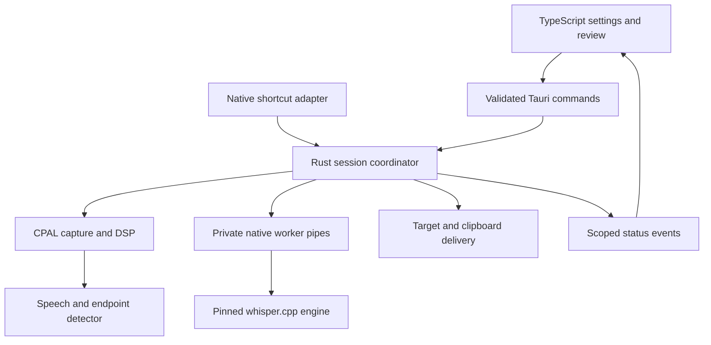

# 03 — Technical architecture

## 1. Runtime architecture

Tauri provides a native desktop host using the OS webview; the UI is TypeScript, rather than native widget code. Rust owns all device and OS integrations. The frontend must never call getUserMedia or perform inference.

The coordinator is the only owner allowed to advance a session or authorize delivery. Audio, inference, and UI callbacks submit typed messages to it. No callback may paste directly.

## 2. Suggested repository layout

| Path | Responsibility |
|---|---|
| `src/` | React/TypeScript UI, presentation state and generated bindings |
| `src/features/onboarding/` | Permission, model and trial flow |
| `src/features/settings/` | Validated forms, status and model management |
| `src/features/draft/` | In-memory review UI |
| `src-tauri/src/commands/` | Small validated IPC entry points |
| `src-tauri/src/coordinator/` | State machine, session ownership and cancellation |
| `crates/audio/` | Capture, format conversion, resampling, endpointing |
| `crates/transcription-protocol/` | Shared versioned worker wire types |
| `crates/transcription-worker/` | Pipe server, whisper.cpp FFI wrapper |
| `crates/platform/` | Target probe, permissions, shortcuts, input/clipboard backends |
| `crates/models/` | Manifest, download/import, hashing, activation |
| `crates/domain/` | Pure types, configuration, errors and policies |
| `vendor/whisper.cpp/` | Pinned source/submodule and build integration |
| `tests/fixtures/` | Consented synthetic/licensed audio and expected results |
| `docs/` | This specification, decisions and platform evidence |

## 3. Concurrency and lifecycle

- Main/GUI thread: OS-required window, tray and platform calls only; schedule work rather than block.
- Audio callback: convert/copy samples into a preallocated bounded ring. No locks with unbounded wait, file writes, network requests, inference, or UI event emission. CPAL's callback is real-time code [S6].
- DSP worker: drain ring, channel-downmix, resample, calculate levels and classify speech. Send meter events at ≤15 Hz. Hold a bounded normalized utterance buffer.
- Coordinator actor: consume start/stop/cancel/endpoint/error messages sequentially; own session ID, draft, target token and dispatch ledger.
- Model I/O tasks: bounded downloader, verification and atomic manifest/config operations.
- Native inference worker: one process, one loaded model, one job at a time. Fixed-length private IPC; no TCP endpoint.

Keep the worker warm after the first model load. Quit closes capture, invalidates session, asks worker to exit, then kills it after a two-second grace period. Parent liveness is tied to pipe EOF; worker exits on EOF. On Windows use a job object or equivalent child-lifetime mechanism; verify no orphan processes. Single-instance enforcement prevents duplicate shortcuts and microphone ownership.

## 4. Capture and DSP pipeline

1. Enumerate devices and query supported stream configurations. Use a supported native sample rate and channel count; do not assume hardware offers 16 kHz.
2. Accept known supported native integer/float formats and convert to bounded finite float samples. Reject NaNs and impossible format metadata.
3. Downmix channels with normalized weights (initially arithmetic mean). Document that phase-cancelled stereo input may require explicit mono-channel selection later.
4. Resample statefully to 16 kHz mono using a maintained Rust resampler candidate, selected and pinned in milestone M0. Test arbitrary block boundaries, 44.1/48 kHz input, drift and final flush.
5. Assemble 20 ms frames: 320 samples at 16 kHz. Convert a copy to signed i16 for the WebRTC VAD candidate. Float32 remains the Whisper input.
6. Keep the last 300 ms of active-session audio as pre-roll. Detect onset after three voiced frames within a five-frame window. A voiced frame must pass VAD plus a conservative calibrated energy floor; use RMS primarily for UI/noise diagnostics, not as the sole speech classifier.
7. After onset, append speech and intervening pauses. A default 1000 ms of consecutive unvoiced frames triggers finish. Include 200 ms of recorded trailing silence. If speech resumes before threshold, reset the timer without splitting the phrase.
8. Explicit stop uses available audio without waiting for silence. With no confirmed speech, finish as no-speech. A <200 ms confirmed speech span is too short and yields no inference; minimum length is tunable from the fixture results.
9. At 120 s total capture, finalize exactly once. On overflow/disconnect/format failure, abort the session with an error instead of transcribing a silently truncated recording.

The WebRTC VAD choice is a design proposal; validate a maintained native binding and license in M0. It is independent of the transcription engine. If the candidate cannot pass fixtures, replace it with a pinned Silero-based local detector behind `SpeechDetector`; record an ADR. whisper.cpp itself documents a VAD integration, which can be evaluated as that alternative [S1].

Only close the microphone when capture ends; do not keep it open for inference. Resampler tails must be flushed once and included consistently. Endpoint time is computed from sample/frame counts and monotonic clocks, not wall-clock time.

## 5. Inference implementation

Use a bundled `dictation-worker` native binary that links whisper.cpp built from a pinned revision [S1]. Generate a narrow Rust FFI layer from that revision's C header or use a maintained wrapper only after compatibility validation. The app's `TranscriptionEngine` trait hides that choice. No external executable on PATH is trusted.

The worker receives validated float32 PCM and a selected language. Run transcription task, not translate. Disable cross-session context carryover. Capture segment text, language result, timing, and available diagnostic scores. Scores are heuristic signals, not calibrated confidence probabilities.

Recommended initial decoding: greedy/low-temperature deterministic path; bounded CPU threads (candidate min(available logical CPUs, 8)); no word-timestamp requirement; suppress non-speech tokens where supported by the pinned API. Map options using actual headers rather than guessing parameter names. CPU profile must work on every shipped target. Metal is an optional build/profile on Apple Silicon with verified CPU fallback.

Reject empty/whitespace-only output. Strip control characters except tab/newline; trim outer whitespace conservatively. Do not delete diacritics or infer commands from transcript text. Do not ship brittle hard-coded “hallucination word” blacklists. Empty speech and noise are controlled primarily through endpointing plus measured decoder rejection criteria.

Timeout: default 60 s per inference job; UI shows elapsed time. A timeout kills/restarts the worker and discards audio. Worker error or crash never triggers a cloud fallback. Re-running canceled audio is prohibited. User retries require a new capture.

## 6. Model pipeline

Bundled trusted manifest fields: model ID, semantic profile, engine format/revision compatibility, language coverage, exact byte count, SHA-256, download URL/allowed redirects, source, license reference and measured resource notes. Manifest data is part of the signed app; no arbitrary remote executable or URL supplied by the frontend.

Download to private `.partial` file, enforce maximum bytes, hash streaming bytes, fsync as appropriate and atomically rename on success. Resume only with validated range/ETag behavior; otherwise restart safely. Only verified files can become active. Offline import uses a native picker, streams from the selected regular file, and validates against approved manifest hashes. Custom untrusted models are outside v1.

Load a newly selected verified model in the worker and run a smoke fixture before committing active selection. If load fails, restart with the previous model. Validate ownership, permissions and file identity again before opening; avoid symlink substitution. Updating the app does not delete installed compatible models.

## 7. Dependency policy

Use Tauri 2 stable and its matching official plugin generation; Rust stable with a pinned toolchain; strict TypeScript; lock Cargo and package manager dependencies. Candidate libraries: CPAL, a stateful Rust resampler, WebRTC VAD binding, serde, Tokio for non-real-time I/O, tracing with redaction, SHA-256 implementation and platform-specific OS bindings. Evaluate licenses, maintenance and actual target support before pinning. These candidates are not a claim that arbitrary current versions work together.
