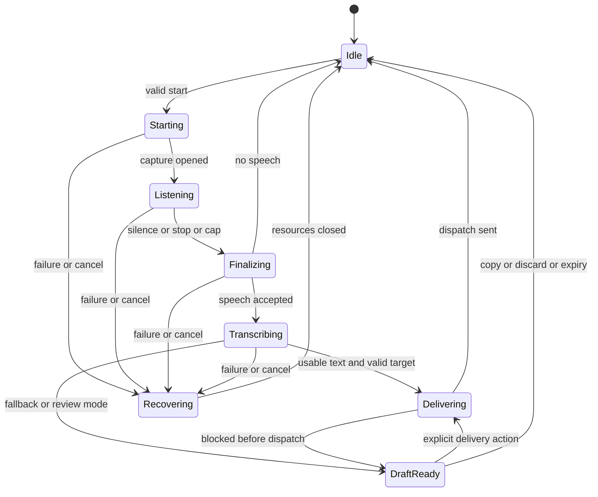

# 04 — State machine, IPC and data contracts

## 1. Orthogonal state

Maintain `Readiness` separately from `SessionPhase`. Readiness contains microphone, model, worker, shortcut and delivery capabilities with reason codes. Copy-only is usable readiness; automatic delivery permission is not a prerequisite for capture. `NotReady` is not a hidden recording phase.

Session phases: Idle, Starting, Listening, Finalizing, Transcribing, Delivering, DraftReady, and Recovering. Error/no-speech/cancel notifications are outcomes that transition to Idle or Recovering rather than trapping the machine in a modal Error state.



Cancellation while Delivering is serialized with the dispatch commit: if processed before commit it blocks the send; after commit it cannot retract text already sent. Show that outcome honestly. A partial/uncertain OS send clears automatic retry eligibility and retains an “attempted” draft requiring explicit confirmation before any resend.

## 2. Invariants

1. At most one capture, worker job and automatic delivery transaction exist.
2. Each session has an unguessable ID, a generation counter, immutable capture settings and a cancellation token.
3. Stop/endpoint races are idempotent: the first valid finish request wins.
4. Every async response must match current session ID, generation, worker epoch and allowed phase.
5. Cancellation invalidates delivery eligibility before tearing down resources. Late results are discarded.
6. The delivery ledger records `not_attempted`, `committed`, `sent` or `uncertain`. A session can cross commit only once automatically.
7. No initial speech means no inference, clipboard read/write, or input send.
8. UI cannot provide arbitrary PCM, executable paths, model URLs, key sequences, target PIDs or automatic-delivery tokens.
9. Opening Review revokes automatic delivery eligibility.
10. Sleep, session lock and logout cancel capture/inference, clear draft, and revoke pending delivery. Unlock never resumes a recording automatically.

## 3. Tauri commands

Rust serde types are the contract source. Generate TypeScript bindings or maintain a checked generated artifact. All mutating requests carry a request ID for deduplication. Validate enum values and numeric ranges again in Rust.

| Command | Input | Response and boundary |
|---|---|---|
| `get_snapshot` | none | Versioned readiness/settings/session snapshot; no raw target token |
| `start_dictation` | request ID | Session ID or typed error; no arbitrary device override |
| `stop_dictation` | request ID, session ID | Acknowledgment only; current phase reconciled via snapshot |
| `cancel_dictation` | request ID, session ID | Acknowledgment; invalidates immediately in coordinator |
| `list_input_devices` | none | Opaque session-stable device IDs and display names |
| `start_mic_test` / `stop_mic_test` | request ID | Exclusive test mode; no parallel dictation |
| `update_settings` | expected settings revision, validated patch | New revision or conflict; applies to next capture |
| `get_models` | none | Manifest-derived model status |
| `install_model` | request ID, approved model ID | Background operation ID |
| `cancel_model_install` | operation ID | Acknowledgment |
| `import_model` | approved model ID | Rust-owned picker/import; UI cannot supply unrestricted path |
| `remove_model` | model ID | Reject if active/in-use without explicit switch |
| `check_permissions` | none | Enumerated permission status, not fabricated bools |
| `request_permission` | explicit permission kind | User-initiated native workflow |
| `get_draft` | draft ID | Review-window only, text and revision |
| `edit_draft` | draft ID, expected revision, text | Validated bounded new revision |
| `copy_draft` | draft ID, revision | Explicit copy; marks completion and clears app draft after success |
| `discard_draft` | draft ID | Clear memory; no clipboard mutation |
| `export_diagnostics` | none | Redacted native save flow, no audio/transcript |

Draft paste is primarily a Rust global-shortcut action: capture the currently focused external target at that deliberate press, validate it, wait for modifiers up, then deliver. A button inside Review cannot reliably select an external caret; label the UI with instructions to focus the destination and use the configured shortcut. No frontend `send_keys` or shell execution command exists.

## 4. Events and reconciliation

Use a scoped Tauri channel or targeted event per window, not an application-wide broadcast containing sensitive data. Envelope:

```typescript
type EventEnvelope<T> = {
  schemaVersion: 1;
  sequence: number;
  sessionId?: string;
  generation: number;
  kind: string;
  payload: T;
};

type Phase = 'idle' | 'starting' | 'listening' | 'finalizing'
  | 'transcribing' | 'delivering' | 'draftReady' | 'recovering';

type AppError = {
  code: 'NOT_READY' | 'BUSY' | 'SHORTCUT_CONFLICT' | 'MIC_DENIED'
    | 'MIC_DISCONNECTED' | 'AUDIO_OVERFLOW' | 'MODEL_INVALID'
    | 'MODEL_UNAVAILABLE' | 'WORKER_CRASH' | 'INFERENCE_TIMEOUT'
    | 'TARGET_CHANGED' | 'PASTE_UNSUPPORTED' | 'CLIPBOARD_BUSY'
    | 'INPUT_UNCERTAIN' | 'STALE_REQUEST' | 'SETTINGS_CONFLICT';
  messageKey: string;
  retryable: boolean;
};
```

Events: phase_changed, readiness_changed, mic_level, model_progress, draft_available, operation_failed. `draft_available` carries ID, expiry and reason, not text. HUD receives only phase, elapsed time, normalized level and hints. Sequence numbers let clients detect gaps and call get_snapshot; snapshots are authoritative after reconnect. Never assume the webview was open when a transition occurred.

## 5. Native worker wire protocol

Version 1; inherited stdin/stdout anonymous pipes. stdout is binary protocol only; stderr is bounded redacted diagnostics. No transcript text in stderr. One reader and one writer per direction. All messages use a 4-byte little-endian unsigned length followed by a UTF-8 JSON envelope, maximum envelope 256 KiB. Reject malformed lengths before allocation.

Sequence: worker sends Hello(protocol, engine revision, backend capabilities); parent validates; parent sends LoadModel(approved absolute path, model hash); worker replies ModelReady or Error. Parent alone resolves that path. Then Transcribe(session ID, generation, worker epoch, language, sample count, PCM byte length) is followed immediately by exactly sample_count×4 little-endian float32 bytes. No interleaving frames inside a PCM payload. Sample count ≤1,920,000 (120 s), PCM ≤7,680,000 bytes. Parent checks finite sample values; worker validates again. Partial payload/EOF aborts the job.

Result: job identity, text, detected language if available, duration and bounded diagnostics. Output text limit 32 KiB before JSON escaping; serialized result must also fit the 256 KiB envelope cap. Progress is optional elapsed/phase only, never a fabricated percentage. Cap decoder segment count and total runtime too. Define shared types in `transcription-protocol` and golden-test framing and bounds.

Hard cancellation: invalidate the job, close pipes and kill the worker process; wait for exit, then restart/load if still needed. This is simpler and more reliable than assuming a particular FFI wrapper can safely interrupt native inference. Keep no worker cache of canceled audio. A cooperative abort callback may be added after proof, but does not replace the generation checks.

## 6. Persistent configuration

```json
{
  "schema_version": 1,
  "revision": 1,
  "audio": {
    "device_id": null,
    "silence_ms": 1000,
    "no_speech_timeout_ms": 8000,
    "max_capture_ms": 120000
  },
  "transcription": {"model_id": "whisper-base-multilingual", "language": "auto", "backend": "auto"},
  "delivery": {"mode": "auto_paste", "clipboard_policy": "leave_text", "excluded_apps": []},
  "shortcuts": {"toggle": "Ctrl+Alt+Space", "cancel": "Ctrl+Alt+Escape", "paste_draft": null},
  "ui": {"show_hud": true, "launch_at_login": false, "locale": "en"}
}
```

This is an application schema example, not a Tauri configuration snippet. OS adapters map normalized chords to actual key representations. `device_id: null` means select/confirm the system default during setup; once selected, persist best-effort device identity and require reselection when missing. No target token, transcript, PCM, clipboard snapshot or permissions grant is persisted. Read OS permission state rather than trusting a saved grant.

*Implemented schema (v3):* v2 added `ui.onboarding_complete` and `ui.reduced_motion`; v3 added `audio.continuous` (ADR-014, default `false`). Older files are migrated forward one version at a time.

Write config to a private temporary sibling and atomically replace after validation. Detect corrupt or future schemas, retain a backup, and offer reset rather than destructive downgrade. Model inventory is separate; transient `.partial` files never count as installed models.
